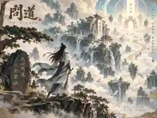
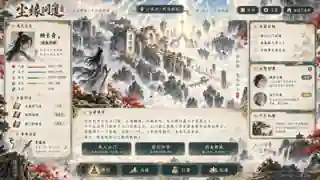

# 美术基准

未来新增大原稿使用[Git LFS与可重现派生策略](../docs/assets/storage.md)，现有原件/历史不迁移。原稿存储与网页运行预算分开核验。

选定第三方案：新国风半写实，暖纸阅读面板、青黛与旧金、云山与少量朱砂。主界面采用已认可的三栏组织，动态文字和操作由网页组件实现。





两图分别为 320×240、320×180 的有损 WebP 预览，只供仓库识别方向；高清原件尚未上传，不能从预览切出正式场景和头像。历史记录称原件保留在会话资料包和图像附件中；T16当前限定查找未取得可回读文件，不能据此宣称它们今天存在。

T18已独立新制4场景和5透明肖像，并接入40个原生SVG符号与四组回执表现，CHECK-06本地已通过，最终远端结果按本轮PR核对。原稿、逐资产完整提示词/回执和导出说明见[production](production/README.md)，机器事实仍以清单为准；不是整图热区，也不冒充历史原件或T25最终认可。


当前文件事实/缺口见[PROVENANCE](PROVENANCE.md)与[asset-manifest.json](asset-manifest.json)，四场景/五肖像/原生UI与表现制作约定见[PRODUCTION_BRIEF](PRODUCTION_BRIEF.md)。历史scene.webp仍是带字风格图的相同副本；T17已停止加载，改由真实地点/阶段控制原生云山与门势，T18已接无字生产素材与原生降级。没有新增字体、音乐或发行许可。

执行 `python3 art/tools/check_inventory.py` 核对文件hash/字节/像素头、状态/来源引用和禁止文件；它不代替完整图片解码、人工审阅或许可判断。

资源校验和 `npm run validate:core` 的文档步骤依赖 [requirements.txt](requirements.txt) 中锁定的 Pillow。源码重建前可在仓库外创建 Python 虚拟环境，避免改变系统包或使源码工作区变脏：

```sh
python3 -m venv ../chenyuan-build-venv
. ../chenyuan-build-venv/bin/activate
python3 -m pip install --only-binary=:all: -r art/requirements.txt
```

本轮干净基线验证使用 Python 3.12、Pillow 12.3.0。网页本机 HTTP 运行只需标准库服务，不依赖 Pillow；此安装要求属于源码校验工具，不代表其他环境或性能矩阵已验收。
