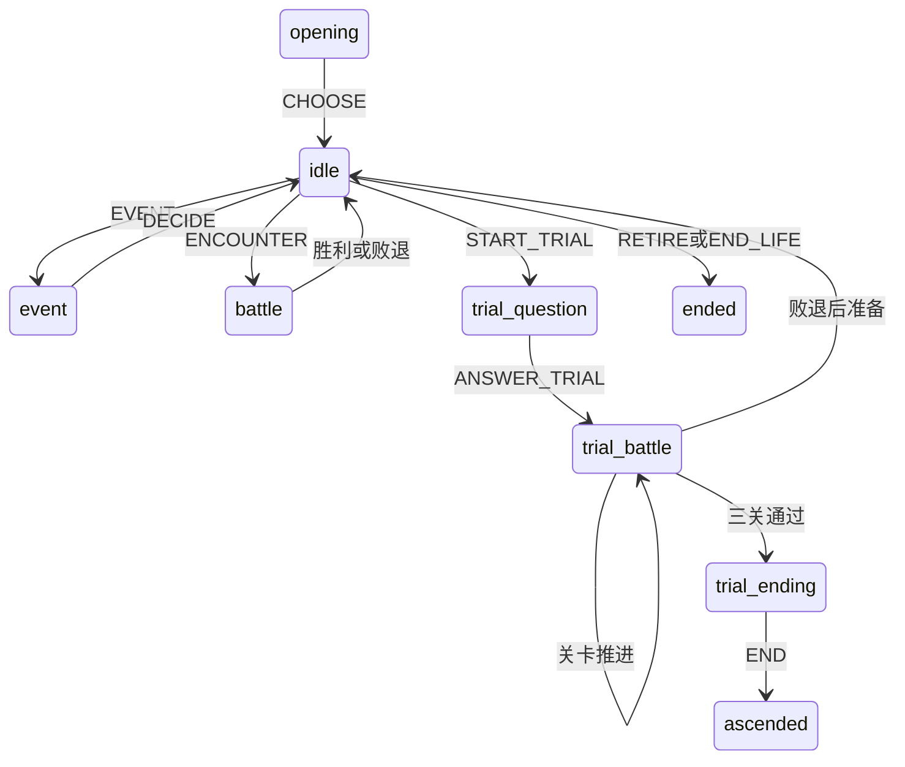

# Full规则、查询与提交契约

日期：2026-10-16。T03落实纯规则/查询契约，T04—T06接通真实事务与正式网页，T07补充目标查询与显示偏好；各阶段验收见独立实施记录。

## 版本与来源

统一常量位于`src/full/versions.ts`：format=`chenyuan-full`，外层version=2，schemaVersion=2，contentVersion=`full-demo.2`，balanceVersion=`full-unbalanced.2`。存储结构仍为原Game字段；没有为显示阶段、目标偏好或检查点向Game添加副本。数值初值保持未平衡。

content版本更新记录本轮结束语义与机制分派变化。数值版本未变；根/web依赖锁也未变。未知format/version/schema/content/balance明确拒绝，不能清空重开。输入先限1000000个UTF-8字节，再解析与验证；字符数不能代替字节上限。

`parseGame`纯转换支持已知M1/Adventure、full-demo.1 / full-unbalanced.1，以及full-demo.2 / full-unbalanced.1。T10将这些已知格式升级到full-unbalanced.2；保留物资、游戏年月、境界、配装及选择，不追补费用或奖励。其他版本组合拒绝。原v1合法RETIRE唯一写出ended/lifespan，年龄仍小于寿限；转换时保留年龄、资源、事件/战斗与历史文本，将该已知错误标签改为retired。当前full-demo.2只有实际达到寿限的终态才能标lifespan。不推测未知版本、数值兼容或旧档没有的经历。数据库层必须保留原档后在副本上调用此函数，成功验证后再提交；纯函数通过不等于数据库迁移完成。

## 一个状态与派生阶段

持久化真源是`Game`。`gamePhase(game)`从status、trial、battle和core.mode派生：opening / event / idle / battle / trial-question / trial-battle / trial-ending / ascended / ended。UI的busy、saved、error和显示偏好属于会话层，不能写入另一套成长状态。

问心阶段必须存在同一run的trial_question实例；中间三关必须有对应battle；结束选择阶段必须idle、无未决事件/战斗且有trial_completed。不能导入“有trial但问心丢失”等无法继续的组合。

RETIRE明确表示主动归隐，不增加游戏年月。END_LIFE只在剩余一个最小游戏月且没有事件/战斗/渡劫时可确认寿尽，推进最后一个游戏月并停止此生；不读取现实时间，也不替玩家选择。仍能突破或准备时可自行选择其他合法行动。T12负责正式界面的原因、确认和恢复入口，不在本轮宣称已接线。

revision与expectedRevision使用非负安全整数，独立于背包/货币数量上限；不能因资源安全上限而使长期存档在第1000000次指令后无法提交。

## 纯结算与结构化结果

所有写入仍提交`Command = Action + commandId + runId + expectedRevision`。一次用户意图重试保留原身份和参数。非法指令、跨run或过期revision拒绝，原快照不变。

`resolve(game, command)`返回`Resolution { nextState, result, checkpointKind }`，不访问DOM、数据库、网络、随机源或现实时间。`advance`保留原有Game返回接口，内部调用同一个resolve。

ActionResult包含指令身份/类型、前后revision、请求/实际步数、实际停止code/message、前后阶段、版本、实际毛成本和净变化。净变化包含灵石/修为/气血/灵力/游戏月/胜场、变化物品以及境界前后值。回灵、同物品返还等不会把毛成本“冲成零”；文本日志不是奖励或扣费真源。

批次逐次计算，已执行步骤才计成本；如50次辅助修炼因预算只执行2次，结果记2次/40灵石并保留INSUFFICIENT_STONES停止原因，revision只增加一次。无成功步骤则失败，不产生假成功回执。

## 共享成本、门槛与查询

`costs.ts`提供`costsForAction`、`requirementsForAction`和剩余游戏月查询。正式结算与预览共同使用，覆盖配方/采购/学习/炼制/突破/渡劫/战斗消耗；UI不重写门槛或收益公式。

| API | 语义 |
| --- | --- |
| previewAction | 调同一个resolver，返回真实allowed/failure、首步成本、请求最大成本、实际成本/步数、净变化与缺口；不暴露伪造的preview指令身份 |
| costDeficits | 规则层资源缺口工具；ActionPreview已结合动作语义返回deficits，UI优先读取该结果 |
| getItemSources | 当前配置的重复来源、炼制、采购、战斗胜利奖励和一次性事件选项；T09增加可选第四参数kinds，缺省行为不变，可在预演前仅选择所需来源类别；未知物品/数量/类别拒绝 |
| getCurrencySources | 当前配置中稳定收入行动，包含真实地点门槛、行动成本、收益和前往步骤 |
| getActionResources | 任意动作的材料/灵石缺口及对应来源，可用于功法、法宝和配方筹备 |
| getBreakthroughGoal | 下一突破/渡劫的真实缺口；已进入渡劫时显示当前阶段，不再要求已经消耗的渡劫引 |

来源规划只在内存副本按合法指令预览“前往→行动”，从不自动执行采购、选择或合成。navigation只是一个待用户点击的前往指令。available表示列出的准备步骤当前可合法执行，不证明战斗必胜；战斗奖励始终标conditionalOnVictory。事件标记一次性，已领取不再可用。

未来境界无法进入的地点保留真实失败原因；无法算到最终动作时costs为null，不把未知成本写成0。最大预算不是批次启动的硬条件；allowed、executedSteps和stopReason来自resolver。所有返回值与输入Game、冻结配置之间无可变资源别名。

## 追踪目标与有界取材（T07）

`goals.ts`的`TrackingTarget`只描述显示偏好：下一突破、物资/目标库存、功法、法宝或事件。`parseTrackingTarget`拒绝未知/额外字段、非法ID/数量；`getTrackedGoal`复用共享查询，完成状态取自真实库存、learned、ownedRelics、choices或人生状态，不预留/补发物资。`trackingConsumption`只预演合法指令，返回会变大的材料缺口；`preparationConsumption`同样提示所选配方筹备受其他消费影响，不锁定实际行动。

`planCollection`返回待点击的SOURCE指令，不执行它：物资目标使用既有target参数与50次单批边界；灵石按共享缺口与配置每次收入规划最多50次，已齐或不产该资源则无指令。物资可能按单次固定产出超过库存目标，不能截掉本应得到的物资。实际步数、成本及停止原因始终来自resolver；灵石计划次数用尽只显示本批完成，不伪造TARGET_MET回执。

网页追踪偏好位于`chenyuan-tracked-goal-v1`（version/runId/target），不写Game或revision。坏偏好回退默认，偏好存储失败不改变游戏的已保存状态。来源面板使用浅层不可变导航栈，避免响应式代理进入纯引擎的structuredClone边界。跨标签页收到较新存档时清除本页旧操作反馈，不把旧回执当作另一页的新结算。

## 本境筹备信息（T09）

`getGrowthStage`读取当前境界、共享突破预览、实际库存/境界记录与配方，派生突破物准备情况、配方最高阶材料及确定/采购来源；材料缺口仍用costDeficits，来源仍用getItemSources。已持有足够突破物不再请求其配方材料；已开始渡劫/结束的人生不虚构新的渡劫引需求。记录数值来自已有milestones，不引入现实时间、奖励、材料预留或新的Game字段。

GrowthPanel自筑基起渐进展示这些信息，不自动替换玩家置顶目标。点击前往复用TRAVEL与普通导航，所有采购/取材/炼制/突破仍另行确认并通过同一原子存档。T09验证止于化神和本境材料，不代替T13—T15渡劫专用流程。

## 效果扩展边界

`mechanisms.ts`登记有限的效果和合法流派/槽位。引擎按配置的effect分派，实体ID仅作稳定引用。相同效果可用新事件、物品/配方、技能或法宝ID复用；新机制仍须实现resolver及行为测试。未知effect和错槽/错流派在配置检查中拒绝。

自动测试在隔离目录只改内容配置，加入一个事件、一种配方/药品、一门复用心法和一件复用法宝，使用相同引擎/查询正常取得、使用和保存；原engine、types、queries与主界面文件不变。该证据证明规则/查询扩展性；正式网页切换后仍需复验通用组件能展示新增内容，不提前代替UI验收。

现有故事requires只表示前置事件发生，不代表曾帮助或结盟。具体选项条件/文本变体由T11落实，本轮不增加未执行的条件字段。

## 事务适配器边界（T04/T05承接）

`contracts.ts`定义CommandReceipt、CommitOutcome和SaveCheckpoint：

1. 同一readwrite事务读取最新快照和原commandId回执。相同身份/参数返回原result并附当前最新state，避免重复奖励和界面倒退；同ID异参数拒绝。原expectedRevision随重试保留，已提交回执先于过期revision判断。
2. 未提交意图按当前状态调用resolve，再在同一事务写完整nextState、原Command/规范化fingerprint/result，以及需要的行动前检查点。事务内部不跨网络await。
3. BREAKTHROUGH与START_TRIAL成功分别返回breakthrough/trial检查点用途；检查点外置完整快照，绑定源run/revision/版本，不递归嵌入Game。失败不得保存半次状态或检查点。
4. 仅事务complete后发布CommitOutcome。abort时保持旧档并明确本次未保存，不能因重读旧档而改报本次成功。
5. 恢复完整准备快照时生成新runId、重建真实event.id实例、清理旧回执；准备检查点保留可重复使用。存在检查点是仓库会话数据，不从Game虚构。

真实数据库事务与正式Store已由T04—T06实施，详见[持久化契约](full-persistence.md)和[T06/CHECK-02](../implementation/goal-1-full-ui-cutover.md)。类型、纯解析或预览不能代替真实事务/页面故障测试。

## 经济审计与数值版本（T10）

灵石辅助每次仍耗1游戏月，炼气20、筑基30、金丹44、元婴58、化神72灵石；以共享costs/getActionCosts为唯一行动费用，UI预算/预览/实际扣费同步。数字仍是未平衡初值。自然吐纳、基础产量、物价、配方、战斗和寿元未因现实时间改奖。

EngineLedger只封装真实resolve，逐次记录指令身份、实际毛扣费/净变化/毛获得及期初期末；毛获得=净变化+实际消耗，不再次叠加配置奖励。突破清零修为另记xpReset，护体回灵与消耗分别记账；HP仅记录净变化，不能用净变化冒充总承伤。失败指令另列，不记成功资源流。完整存档回滚建立新的账本段，不把恢复快照当作收入。账本不表示事务已保存。

`npm run audit:economy`重新执行120组正常引擎路线并逐字校验版本、源码摘要、分境账本、对照/转换/战斗/失败恢复报告。它不证明完整网页飞升、全局最优策略、真人平衡或真实分钟时长，范围及剩余风险见[T10记录](../implementation/goal-1-economy-ledger.md)。
