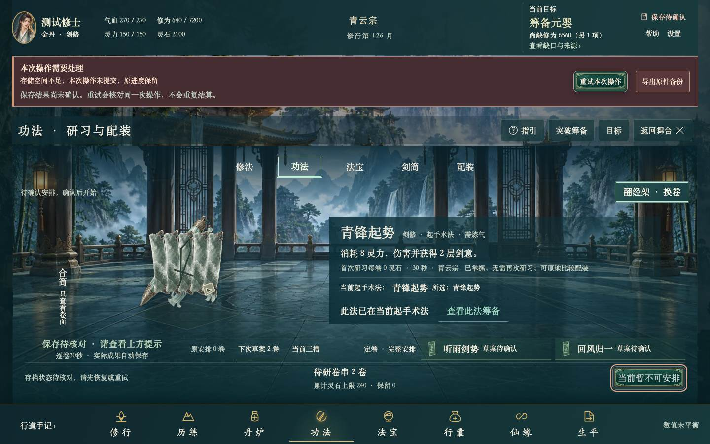

# ART36：保存失败时仍以经卷和下一步为中心

本项本地工程检查通过，代码提交 `dcdc11c`，运行源 `5db63d9a8ec8279ba4c8edaf16a356b2103ae58b9740d85f5353f0ee278ee03d`。这只关闭 CHECK85-ART-OBS-01 的定向修缮，不代表整个游戏美术、长期玩法或真人验收完成。

原错误横幅下，12卷主体实际 alpha 投影长边约114—122px，剑简约144px；原正常约276px。旧合同允许错误态优先保完整文字，不能声称旧状态违反正常200px目标。本轮另定错误态180px项目目标。保留原102px错误全文、原意图重试和备份，将场景状态与双卷安排并排、完整授权独立一行，减少物件内部竖向留白。最终13对象最小182.662px，正常200px门槛未降；没有缩字、裁内容、删能力或新增画件。

## 实际检查

- 干净提交副本的四个完整相关文件27例通过，0跳过、重试、报告错误。348个实际输入前后同哈希、同干净Git；110个HTTP载荷与构建一致。A1/A6保原断言并追加全部12卷和剑简、双卷草案、真实START写入失败、完整库不变、18px正文/44px控制、一屏边界和失图检查。原A9四条件及60秒上限保留，41.5秒通过。
- 原30/60秒周期、前1ms、保存中不掌握、完整Game/Activity/回执/全库、暂停/同id接管与旧回执边界由原完整用例实际执行。虚拟钟仍只证明规则，原真实30/60秒用例也保留；不据此宣称长期节奏或趣味通过。
- 正向资源与575项资源方法通过，其中本项8个有意义的合同/预算/原主体完整性反例。干净源码类型检查和正式构建通过。新增CSS894B、main仅34B导入，合并旧CSS2512/4800B、合并原生3531/7200B；旧文件、控制器和资源账本不重签。去掉明确新增导入/助手/两处调用后，旧测试全文可严格恢复，原断言与案例没有减少。
- 当前12张图已逐张查看，每次最多两张；同尺寸JPEG68仅用于查看，原PNG保留。涵盖已悟/未悟、剑符/剑简、双卷、失图、正常、运行、保存中、成功和暂停。原/首版失败及全部报告保留，179.979px的首版没有放宽阈值过关。

作者27例与追加双卷2例是前置证据，不再加入最终27计数；前轮1263全矩阵仍对应旧7aff运行源，不换标签冒成本轮新源全矩阵。规则与存档模块未改，不重复宣称本轮运行完整415原生或868核心套件。

## 可运行成果与边界

[新版本机试玩](http://127.0.0.1:56885/)服务干净提交的dist，110载荷11184252B全同，三条私有路径404。Chrome已打开并保留欢迎页，显示尚无存档，未执行游戏动作。当前选定Chrome未找到原56884标签，所以原试玩未更新、未刷新、未读取用户DB/fullGame或迁移进度。不同端口属于不同存档来源。

本地包在 `artifacts/goal-4/art36/art36-local-preview-dcdc11c.zip`，10101103B，SHA256 `346cd14a0bb1868b51a763cc9fdc060d063126ca2b07afa3b1cb4c6fd1052937`。包含110网页载荷、原安全loopback服务脚本、构建身份及运行说明，无存档。实际解包逐文件同哈希；没有另起解包实例，当前服务使用字节相同的干净dist。这是局部工程试玩包，不是原目标的正式认证候选。

原13项在途文件逐哈希保持，无push/merge、公开部署、权限或自动化变更。所有兼容和环境性能工作继续暂停。正式同源候选、最终完整矩阵、最大C端/代码/安全评审、整体美术与长期平衡/真人验收，以及J01、ART17四红、ART28-OBS-01、COMPAT-OBS-1200-01和原输入补录限制均保留。

## 杠精审查

通过本项合同：真实主体增大、完整错误/授权/目录/原重试仍可用，CSS只命中既有failed态，未改规则、时钟或保存权。源/旧测试严格逆变换和原预算均有据，不以图片容器、绿灯或当前小改动代整体用户认可。第一版量值不足已修，原红保留；未完成项未隐去。

复用既有game-ui-frontend、alpha投影、PNG采集、资源检查与同源观察工具，没有另建重复Skill/工作流。下一独立任务仍为CBASE-DOC-02；本项是综合检查后的第1项，三任务检查规则不变。

详见 [检查](checks.json)、[真实alpha](alpha.json)、[来源/预算](source-audit.json)、[同源与本地包](identity.json)、[像素审阅](visual-review.json)、[尝试记录](attempts.json)、[未完成项](remaining.json)。原始日志、原PNG和冻结输入保存在ignored `artifacts/goal-4/art36/`，哈希列于检查记录。
