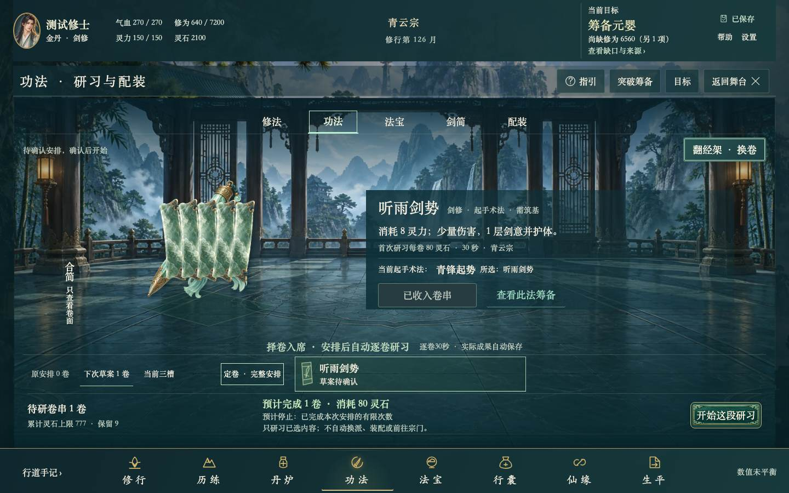

# CHECK-UX27-ART35-CEND03 综合审查

2026-11-01；本轮原话、0081合同、参数/验收/回滚和13在途保护先于代码。沿既有Goal4，评审固定点38ab324…3047c1a，当前运行源码 `f16c376203984436d0e4d3c9b6b12ccbee95189605829aefccb6e08a8a391a13`。

**本独立综合检查已本地交付，代码提交`15cb075efccbff21499c1adea4db53ae98734f04`，同源试玩已更新。** 新读取的完整正常32例已在原240秒/2worker下全部通过，0skip/retry/report错误；不以此宣称整体目标、美术、长期平衡或真人验收完成。

## 解决的问题

付费经卷收入卷串后，完整授权与卷串占用阅读高度，实际画件最长边只有144.88875px，低于原200px要求；同一旧源被动诊断再次得到相同值。当前只把正常skills的卷串分类/内容并列，并减少绘画按钮留白，实际腾出阅读空间，保全部四类查看、两卷分页、三槽、文字、预算和开始/暂停/回看。

生产运行源只增343B CSS：1618/4800B，图片加载hook仍1019B，合计2637/7200B；原所有帽/全文pin不变，0新素材/模块/规则/时钟/存储/数值变化。第一版absolute300虽达到画件尺寸，却在原ART10-A3实际裁切检查失败，已完整撤销；原断言不降，新复制frame对jade的临时例外也已删除。[范围和原权属](source-scope.json)。

独立Spec审查另发现原CEND03只查看完整准备恢复，没有实际点取消。已补原“保留当前进度”点击、确认退场、稳定来源焦点和取消后全部DB不变；没有执行恢复或改生产回调。[双轴审查](standards-spec-review.md)。

## 当前验证分层

当前常规界面791唯一：首完整常规轮774过/17红保留；其中15是本轮作者从仓库根启动CLI，旧演示文件检查要求web工作目录的相对public路径，实际HTTP/演示文件均存在；另2触原60秒总时限。更正调用目录后，完整重跑四个受影响文件51过，原每例60秒/2worker/全部业务循环与断言保持；剩余740例直接保留同源已过执行。再加原七个慢例单worker全过，原798唯一有据，**不是单轮798全绿**。后续验证读取调整只影响两个UI调用文件的8例，已完整替换为本次重跑，再加3读取探针，目前801个唯一UI例均有通过证据；原执行与新helper闭包分开记录。不重写原774/17，也不将重复51增加覆盖数。[常规来源](regular-current-coverage.json)。

同源原生415整轮过，原60发布源案例实际执行，原22过时即时setup保持原件/退休边界，其全部替代链逐一绑定本轮415真实过例。[迁移义务](native-migration-audit.json)。根规则/工具873、资源559完整原方法均过；资源先真实root与完整sandbox正向，再全方法。它们不代表环境性能/兼容矩阵执行。

三个新组合覆盖非默认付费一卷/777预算/9保留、五分类标题/导航/返回与六轮廓实际200px；6秒单丹native TICK失败后编辑下次草案仍只重试原一个命令；实际30秒疗养完整体魄/月份结果；60秒剑简同id新generation接管、原页草案与旧奖不重演。前1ms无成果、到期正式唯一Game/Activity/canonical回执/全部DB9及CP-owner证明均保，原五个完整oracle/frame函数逐字一致。[完整原校验](unchanged-complete-oracles.json)、[四周期摘要](early-four-cycle-proof.json)。

当前25动作真实只读入口、15主线阶段和两补例均在完整回归中重新执行；全部原动作允许/主控件可用，查看后GameDB不变；真实已保存完整CP核对后实际取消/焦点返回有据。合法fixture不冒正常赚取或真人理解。[当前观察](current-observations.json)。

87张当前代表图全部复核：50逐张实看、37整张PNG与确审图逐字节相同继承；原PNG/同尺寸有损JPEG68与hash/来源链保。包含两入口五分类、七种画件、五叶/运行/保存/已悟/失图、恢复以及主线/确认，不声称全矩阵所有截图已审或用户认可。[像素](visual-review.json)。

## 验证读取的限定调整

完整32正常路线后续实际30过/2总240秒超时，原报告/trace保。被动trace显示约2127次Evaluate累计89.7秒并已完成第三关，不能据最后操作名编造玩法断点。只将测试runVisibleIdleRoute原相邻完整Game/Activity读取合为一个readonly事务/往返；应用/规则/原动作/240秒均不改。程序AST证明原54处matcher/预期表达式顺序相同，所有其它函数/顶层语句逐字同；checkArt03Read原全库不变断言也不动。

新3例验证缺DB不创建、undefined/Date/数组/null完整保真、真实受理/原生失败与旧意图重试同旧两读全等。首轮最后一例因作者误假设修炼回执为v2而红，按原v1七字段/无proof和v2完整proof分支修，原件保；新3与两个完整UI调用文件共11过。新读取后的完整正常三文件32例全部通过，原2worker/每例240秒及全部动作/周期/刷新断言保持，0skip/retry/report错误。原30过/2总超时仍保，不凭本轮绿宣布原未知原因已修。[读取对等](joint-read-source-and-assertions.json)。

## 失败、未知和边界

所有早期红、废案、主动中断和启动守卫分相记录，不计通过。旧build树严格拒绝在产品例前发生，正常重建当前记录而非伪改旧metadata；并行normal继承4173导致端口冲突时尚未进产品例，隔离同一个本地预览到4175后才执行。两个60秒目录超时与四个240秒正常路线总超时的根因仍unknown，不凭后续过例宣布修复；最后失败API约1.6—106ms，不能说该控件本身等待了240秒。[原尝试](attempts.json)、[时限诊断](normal-timeout-diagnostics.json)。

证据保留有一处明确不足：首early-v1复用输出目录后，独立原trace没有另存。原失败报告/冻结测试源码，以及同一旧运行源、同144.88875值的另一次被动诊断trace/PNG仍在；后续目录均独立。不能写“所有原trace齐备”。

T02（恢复当前决定的耗时前告）和I04（异地不可执行零预估措辞）本轮未修，仍按下一独立任务执行。已有先导6/30秒、正确地点原因与可达旅行CTA不忽略，也不把592/600高于正式80%门槛编成恢复阻断。

当前仅固定1440×900/font1单Chromium。兼容/环境性能持续暂停；J01旧初读unknown、ART17四旧红、ART28-OBS-01、COMPAT-OBS-1200-01、旧艺术/M04与最终完整矩阵、干净同版候选、最大C端/代码/安全review、长期平衡和真人复验全部保留。机器绿不能推翻用户整体游戏感/美术负面反馈。

已复用game-playtest、review、既有Playwright/完整oracle与资源/身份工具；没有新增Skill、永久代理流程或自动化。13原无关在途/旧画/原输入/v0.3/存档与冻结包保留；不推送、合并、公开部署或改权限。

## 同源交付与本项审查

当前801唯一UI/415native/32正常/873规则工具/559资源与87代表图已核，详细分相见[检查](checks.json)和[覆盖](coverage-audit.json)。323运行输入与实际代码Git/工作区、受测/重建/冻结110载荷11,183,415B和HTTP解码逐字节相同；现有helper原样复用且只loopback，旧D0包保持。[身份](identity-proof.json)、[HTTP](http-identity.json)。

原Chrome只在公开已保存/活动停止/无编辑后刷新，实际新JS qIvu8_D0/CSS Xmwf3Vlw请求有据，公开60血/20灵/10修为/40石/吐纳停止2/50与刷新前相同。无用户DB/fullGame读取、用户档测试或Game动作。reload后原生AX/像素一度空白，Raise原窗口恢复当前真实画面，未借此改环境/权限或宣称产品根因修复；自然旧1200窗口已知叠字仍保暂停，不作为固定1440矩阵通过。[试玩](user-preview.json)。

[杠精审查] 通过0081本独立范围：真实两次布局红后最小修缮，原200/18/14/44/裁切与完整能力/预算/原意图/完整Game-Activity-唯一回执-全DB/CP-owner不降，所有当前唯一案例有实际过例与明确执行来源；新验证读保持原54断言并完整复验全部调用者/正常32。原774/17、30/2、启动守卫/中断/作者前提错及首trace保留不足均明确，未把旧源、重复次数或工程绿冒全产品/艺术/长期/真人。13在途/原输入/v0.3/旧图/存档与旧包保，没有已知本项未修功能阻断；旧未知和最终义务不关闭。

下一轮只推进T02恢复行动前耗时，I04另任务随后，继续原目标。完整目标保持active；本检查、同源工程包和用户整体认可分开。
