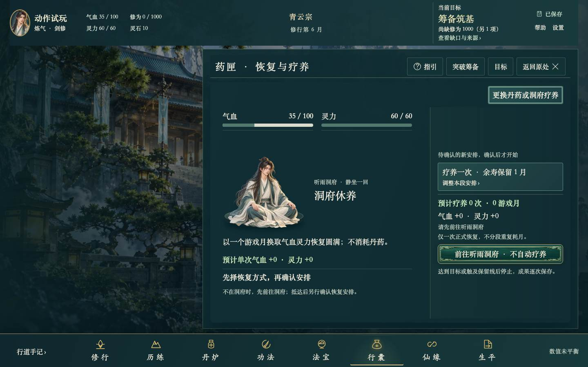

# REVIEW-C-END-03 · 当前主线与操作易用性再审

2026-11-01；基线 `ce7bf52401ecd4bfc3d424f39679e4e9cc931d47`，运行源码 `d0b22d1464abdb9d3908b09d229085a0ba4feeebfbc7891e84866817308cc8b0`。本项为工程审查交付，生产代码、资源、规则、周期、DB9均零改动；不等于整体游戏、艺术、长期平衡或真人验收。

## 当前发现

| 编号 | 级别 | 玩家所见 | 后续独立修缮 |
|---|---|---|---|
| CEND03-T02 | P2 | 服丹/疗养当前决定与完整安排未保留耗时；异地“前往听雨洞府”未写6秒 | 当前动词旁从正式周期常量显示每丹6秒、疗养30秒或旅行6秒，保原预算、命令和时钟 |
| CEND03-I04 | P3 | 异地疗养显示“恢复+0、0次、0月”，易被误解为疗养无效 | 沿真实不可执行门槛说明“抵达后再预估”，不伪造未来恢复或暗中旅行 |

T02不是全流程从未说明：行囊用途入口已有“每丹6秒”，修行入口已有“每次30秒”，方式选择已有6/30秒。缺口在进入当前决定后的信息保留。I04已有准确的地点原因和可达旅行按钮，正式不可执行预估为0也不证明规则错误；这是表达建议，不称玩法阻断。[逐项来源、反证与验收](findings.json)。

## 当前证据与结论

同一冻结输入完整执行42例：原15主线、正式25 Action的真实只读决策入口、异地恢复和真实完整入场检查点两补例；42唯一通过，0跳过/重试/报告错误，原60秒单例、8秒操作、15秒导航保持。25动作均在合法前置上可达、正式原动作允许、当前主控件可用，查看/草案/核对后全部Game数据库不变。SCHOOL/EQUIP/EQUIP_RELIC为比较后即时原子确认，无秒数不作缺陷；其余22类中20类当前决定有真实秒数，USE/REST列为T02。当前8舞台按真实子玩法、当前对象和能力链登记，未将8个入口冒所有子状态。[检查](checks.json)、[25动作](actions-matrix.json)、[15阶段](mainline-matrix.json)、[8入口](stages-matrix.json)。

15阶段从破庙到真实封卷逐个核当前目标/缺口/来源/下一步，未在覆盖状态复现新的流程阻断。合法fixture只证明这些UI状态，不是正常赚取或长期游玩。渡劫撤退后的592/600高于正式80%入场门槛，已有引、没有遭遇且人在洞府时指向登仙台是正确的，不编造必须先恢复。补例通过真正15秒登台、6秒问心、3秒撤退的正式活动和完整周期helper创建检查点，完整快照等于入场准备且归当前人生；恢复确认说明整份物品、体魄、配装、选择与年月一同回退。本次只查看恢复确认，**未执行恢复**；虚拟钟也不证明现实成长节奏。

40张当前代表画面逐张实看、0图继承；原PNG全保，查看副本为原尺寸有损JPEG68，哈希逐一核对。曾遇上下文过大，两张没有据工具返回假认审过，改为分别重新打开后才登记。开场、来源、经卷/剑简与静坐画件已有对应工程变化；普通符号图标不因是矢量就强造美术缺陷。[像素记录](visual-review.json)。旧七问题分别对应ART33/34、UX24—27、ART35，当前观察和精确同运行源原报告支持工程落实，**整体游戏感与用户负面反馈仍保留**。[旧问题逐项](old-seven-issues.json)。

实际动作结算证据分层：ART35原154 UI/25 native/873规则/559资源属于精确同运行源的既有执行，本项不重跑或改日期；其中与动作表键匹配的FORGE/LEARN/STUDY/三配置/BUY/SELL/USE/REST逐例引用。其它旧执行仅在102个App函数体与六个正式存储/规则文件精确不变的范围继承，不说当前UI重新执行了它们。旧全768 UI/415 native/32正常路线未在本项重跑。[继承](inheritance.json)、[源码函数与完整文件证明](callback-source-proof.json)。

当前323运行输入与工作区/基线Git逐字节一致，HTTP全部110载荷11,183,074B一致，445采集输入未漂移，13个原无关在途未改。因生产运行源零变化，没有重建、重启或强刷用户试玩，也未读用户DB/fullGame或用用户档测试。[身份](identity-proof.json)。

## 失败与局限

v1完整40过；v2完整41过/1作者前置错误：首个USE fixture其实在洞府。保留原失败、源码、trace，只用正式TRAVEL到sect的合法前缀纠正测试前提；v3完整42重新执行通过，不拼接旧结果，不改产品或放宽断言/时限。元数据脚本的文件名、容器类型、封卷字段和Action联合类型解析失误均只纠正审查脚本后重核，不写成产品失败。[原尝试](attempts.json)。

当前固定1440×900/font1单Chromium，兼容及环境性能仍暂停。正常完整路线、全部边支/长文、长期平衡/趣味、真人理解与整体艺术没有借这42例宣称通过。J01原生初读unknown、ART17四个历史失败、ART28-OBS-01、COMPAT-OBS-1200-01、M04及其他旧艺术/最终全矩阵/干净同版候选/最大C端代码安全review/真人复验责任不关闭。

## 审查交付与下一项

[杠精审查] 通过本项审查范围：25Action与15阶段不是仅看入口；新发现有实际画面/原始文字、反证、真实消费者及独立修缮验收，没有为凑问题制造低血量阻断、把即时配置加假等待或把局部美术替换冒真人认可。已知两问题是本次审查产出，保持待修，不以“审查完成”冒“问题已修”。没有删原能力、旧断言、旧失败或提高预算/时限。生产零变，存档原件与13在途保持。

本组三项UX27→ART35→CEND03已到第3项。下一轮先做 **CHECK-UX27-ART35-CEND03** 独立综合检查-debug，之后分别修T02与I04，再沿真实待办和最终义务推进。Goal保持active，当前不是最终工程候选或用户验收。
